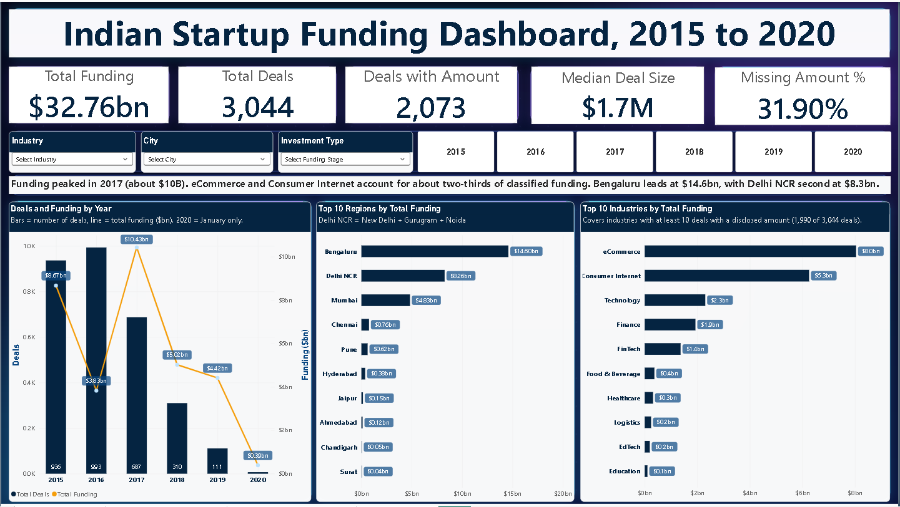
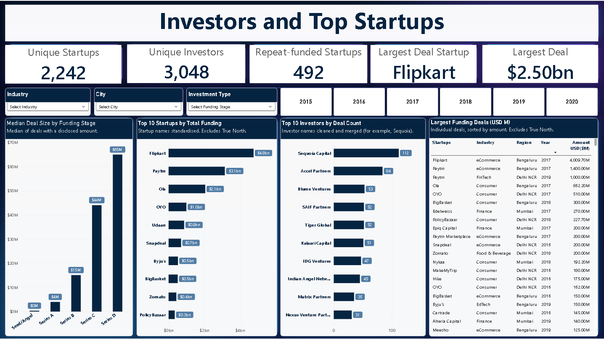
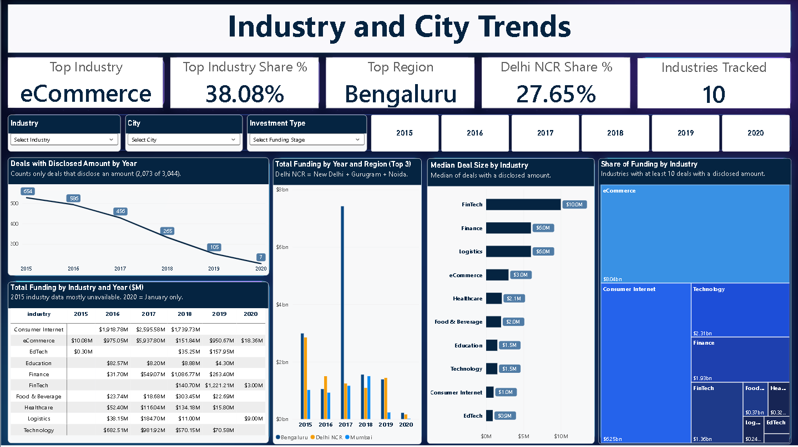
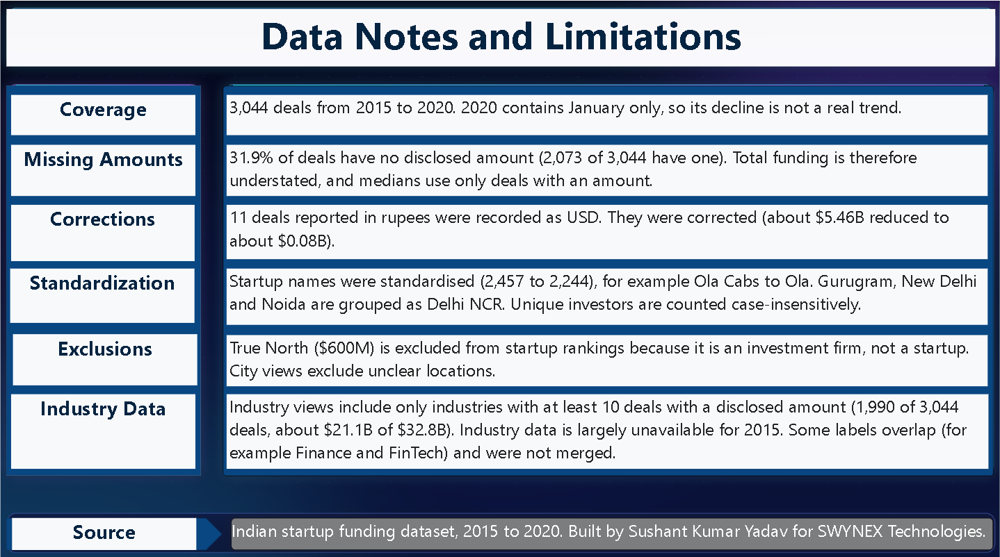

<div align="center">

# Indian Startup Funding (2015 to 2020): End-to-End Data Analytics Case Study

**SWYNEX Technologies · Data Analyst Internship · Task 4: Final Data Analytics Project**


*From a raw, messy Kaggle file to a cleaned dataset, a verified analysis and a four-page interactive dashboard, with the business insights and the data limitations stated openly.*

</div>

---

## Table of Contents
1. [Problem Statement](#1-problem-statement)
2. [Project Pipeline](#2-project-pipeline)
3. [Dataset Information](#3-dataset-information)
4. [Data Cleaning Process](#4-data-cleaning-process)
5. [Analysis](#5-analysis)
6. [Dashboard](#6-dashboard)
7. [Key Business Insights](#7-key-business-insights)
8. [Recommendations](#8-recommendations)
9. [Limitations](#9-limitations)
10. [Tools and Skills](#10-tools-and-skills)
11. [Repository Structure](#11-repository-structure)
12. [How to Reproduce](#12-how-to-reproduce)
13. [Video Walkthroughs](#13-video-walkthroughs)
14. [Key Learnings](#14-key-learnings)
15. [Author](#15-author)

---

## 1. Problem Statement

India's startup ecosystem attracted billions of dollars between 2015 and 2020, but the public data about it is messy: amounts stored as text, the same city or investor written in many ways, and some amounts recorded in the wrong currency. A founder, an investor or an analyst who uses this data as it is would draw wrong conclusions.

**This project answers four business questions:**

1. How did startup funding in India change over time: in the number of deals, the total money and the typical deal size?
2. Which industries and cities attract the most funding?
3. Who are the most active investors, and which startups raised the most?
4. How much can we trust the numbers, and what should a reader be careful about?

**Goal:** turn the raw data into reliable, decision-ready insight, and show every step so that the result can be audited.

---

## 2. Project Pipeline

The work was done in three stages. Each stage has its own folder, notebook or report, and README with full detail.

| Stage | Task | What was done | Output | Folder |
|---|---|---|---|---|
| 1 | **Data Cleaning & Preparation** | Detected and fixed data-quality problems with pandas and regex | `cleaned_startup_funding.csv` | [Task-1](Task-1/) |
| 2 | **Exploratory Data Analysis** | Audited outliers, corrected wrong amounts, analysed trends by year, industry, city, investor, stage and startup | `startup_funding_eda.csv` | [Task-2](Task-2/) |
| 3 | **Interactive Dashboard** | Built a four-page Power BI report with 18 DAX measures | `.pbix` + PDF + screenshots | [Task-3](Task-3/) |

```
Raw Kaggle data → Clean (Python) → Audit & analyse (Python) → Visualise (Power BI + DAX) → Insights
```

---

## 3. Dataset Information

| Property | Detail |
|---|---|
| Source | Kaggle, Indian startup funding dataset |
| Raw size | 3,044 rows × 10 columns |
| Period | January 2015 to January 2020 |
| Content | Funding rounds: date, startup, industry, sub-vertical, city, investors, round type, amount in USD, remarks |
| Final analysis table | 3,044 rows × 16 columns (`startup_funding_eda.csv`) |
| Investor table | 5,571 rows, one row per investor per deal (`investors_clean.csv`) |
| Deals with a disclosed amount | 2,073 of 3,044 (68.1%) |
| Total disclosed funding | **$32.76B** (after corrections) |

---

## 4. Data Cleaning Process

*Full detail, code and verification: [Task-1](Task-1/).*

Every problem was **detected first, fixed second and verified third.**

| Problem found in the raw data | How it was handled |
|---|---|
| `Date` and `Amount` stored as text | Converted to `datetime` and `float` |
| 8 malformed dates (for example `05/072018`, `01/07/015`) | Repaired with regular expressions, zero unparseable dates left |
| Amounts with Indian commas, `+`, `undisclosed`, `N/A` | Cleaned; non-numeric values became missing (`NaN`) |
| 50+ labels for investment type | Grouped into 16 clean categories |
| City spellings (Bangalore / Bengaluru, Gurgaon / Gurugram) | Standardised |
| Hidden encoding junk (for example `Byju\xe2\x80\x99s`) in 27 startup names and 92 investor entries | Decoded back to real characters, 0 left |
| Missing text values | Labelled (`Undisclosed`, `Unknown`, `Not provided`) |
| Unusable column headers | Renamed to short `snake_case` names |

**Key decision:** the amount column was **not imputed**. An undisclosed amount is a real fact, and filling it with an average would invent money that was never raised.

---

## 5. Analysis

*Full detail, charts and code: [Task-2](Task-2/).*

### 5.1 The outlier audit

The raw data had a very large gap between the mean and the median deal size (mean about $18.4M against a median of about $1.75M), which pointed to wrong values. Outliers were detected **inside each investment type** (Q3 + 3 × IQR) and every flagged value was checked against public news reports.

**Result:** 11 deals reported in **rupees** had been recorded as **USD**. After correction, about **$5.4B** disappeared from the total (about $5.46B reduced to about $0.08B). The original and corrected values are both kept in the data, so every change can be audited.

Without this step, the dashboard would have shown a wrong "largest deal" and a total that was about $5.4B too high.

### 5.2 What was analysed

| Analysis | Question answered |
|---|---|
| Trend by year | How did deals, funding and median deal size change? |
| By industry | Which sectors attract the most funding? |
| By city | Where is the money going? |
| By investor | Who is the most active? |
| By funding stage | How does deal size grow from Seed to Series D? |
| By startup | Who raised the most, and who raised repeatedly? |

---

## 6. Dashboard

*Full detail, all 18 DAX measures and design decisions: [Task-3](Task-3/).*

A four-page Power BI report with shared slicers (Industry, City, Investment Type, Year). Every KPI is a DAX measure, so it recalculates for any selection.

### Page 1: Overview


### Page 2: Investors and Top Startups


### Page 3: Industry and City Trends


### Page 4: Data Notes and Limitations


---

## 7. Key Business Insights

| # | Finding | What it means |
|---|---|---|
| 1 | **Fewer, bigger deals.** Deals fell from 993 (2016) to 111 (2019), while the median deal rose from about $1.0M to $6.2M. | Money moved toward fewer, more mature startups. Total funding stayed high even as deal count collapsed. |
| 2 | **2017 was the peak for money** (about $10.4B from 687 deals), driven by a few very large rounds such as Flipkart. | Yearly totals are dominated by a handful of mega-deals, so the median is a better guide to the typical deal. |
| 3 | **Funding is concentrated by industry.** eCommerce ($8.0B) and Consumer Internet ($6.3B) make up about two-thirds of classified funding. eCommerce alone is 38.08%. | The ecosystem was built around consumer-facing business models. |
| 4 | **Funding is concentrated by city.** Bengaluru ($14.6B) and Delhi NCR ($8.3B) together hold about 70% of total disclosed funding. Delhi NCR has more deals but less money than Bengaluru. | Bengaluru gets larger rounds, while Delhi NCR gets more but smaller ones. |
| 5 | **Stage drives deal size.** Median deal size is under $1M for Seed/Angel, then $4M (Series A), $15M (Series B), $44M (Series C) and $65M (Series D). | Each stage is roughly a 3x to 4x step up, a useful benchmark for fundraising plans. |
| 6 | **Deal size differs by industry.** FinTech has the highest median ($10.0M); Consumer Internet has a $1.0M median despite high total funding. | Consumer Internet total funding comes from many small deals plus a few huge ones; FinTech deals are consistently larger. |
| 7 | **A few startups take a large share.** Flipkart ($4.8B), Paytm ($3.1B) and Ola ($2.1B) together are roughly 30% of all disclosed funding. | Totals and rankings are sensitive to a few names, which is a concentration risk. |
| 8 | **Investor activity is concentrated.** Sequoia Capital (112 deals) and Accel Partners (84) are far ahead of the rest of the top 10. | A small group of funds is behind a large part of the deal flow. |
| 9 | **Repeat funding is common.** 492 of 2,242 startups (about 22%) raised more than one round. | Follow-on funding is a normal part of the journey, and a first round does not end the story. |
| 10 | **Disclosure is incomplete and falling.** 31.9% of deals have no amount, and disclosed deals fall from 654 (2015) to 105 (2019). | Totals are a lower bound, and early years are understated more than later ones. |

---

## 8. Recommendations

These are conclusions the data supports. They are not predictions.

**For founders**
- Plan fundraising around stage benchmarks: a Seed round is typically under $1M, and Series A has a median of about $4M. Asking far above the benchmark for a stage needs clear proof of traction.
- Expect investors to prefer fewer, larger bets. Show growth and repeat-funding potential, not only an idea.

**For investors and analysts**
- Do not read industry totals alone. Compare totals with medians: a sector with high total funding and a low median (Consumer Internet) works differently from one with a high median (FinTech).
- Treat rankings as sensitive to a few mega-deals. Check how a result changes when the largest deals are removed.
- Look at Delhi NCR and other cities beyond Bengaluru for volume of deals, and not only for size.

**For anyone using this kind of data**
- Report the share of missing amounts next to every total, and use medians for "typical" values.
- Audit outliers before charting. In this project a single data-entry mistake (rupees stored as USD) added about $5.4B.

---

## 9. Limitations

- **Missing amounts:** 31.9% of deals have no disclosed amount, so total funding is understated. Medians use only deals with an amount.
- **2020 is January only** (7 deals), so its fall is not a real trend.
- **Possible collection bias:** the drop in deal count after 2016 may partly reflect how the data was gathered, and not only the market.
- **Corrections:** the 11 rupee-as-USD fixes used public news reports and approximate exchange rates (Rs 71 to 72 per USD). Smaller cases of the same error may remain.
- **Industry labels:** about 800 free-text labels remain; only common variants were merged. Industry views use industries with at least 10 deals with a disclosed amount, and some overlapping labels (for example Finance and FinTech) were not merged.
- **Exclusions:** True North ($600M) is excluded from startup rankings because it is an investment firm. City views exclude unclear locations.
- **Descriptive only:** the analysis shows patterns in the data. It does not prove causes, and it ends before the 2020 pandemic.

---

## 10. Tools and Skills

| Area | Tools and techniques |
|---|---|
| Data cleaning | Python, pandas, regular expressions, type conversion, label standardisation, encoding repair |
| Analysis | pandas, matplotlib, IQR outlier detection, groupby analysis, medians vs means, data validation |
| Dashboard | Power BI, DAX (CALCULATE, KEEPFILTERS, REMOVEFILTERS, TOPN, SUMX, RELATED), data modelling (fact + investor table), slicers, cross-filtering |
| Practice | Detect → fix → verify, documentation of assumptions, no imputation of undisclosed amounts, version-controlled work on GitHub |
| Environment | Google Colab, Power BI Desktop, GitHub |

---

## 11. Repository Structure

```
SWYNEX-Data-Analyst-Project/
├── README.md                     # This case study
├── LICENSE                       # MIT license
├── startup_funding.csv           # Raw data (untouched), kept at the root
├── Task-1/                       # Data Cleaning & Preparation
│   ├── README.md
│   ├── Indian_Startup_Funding_Data_Cleaning_&_Preparation.ipynb
│   └── cleaned_startup_funding.csv
├── Task-2/                       # Exploratory Data Analysis
│   ├── README.md
│   ├── Indian_Startup_Funding_Exploratory_Data_Analysis.ipynb
│   ├── startup_funding_eda.csv
│   └── images/                   # 6 charts used in the Task 2 README
└── Task-3/                       # Interactive Dashboard
    ├── README.md
    ├── Indian_Startup_Funding_Dashboard.pbix
    ├── Indian_Startup_Funding_Dashboard.pdf
    ├── Page_1_Overview.png
    ├── Page_2_Investors_and_Startups.png
    ├── Page_3_Industry_and_City_Trends.png
    ├── Page_4_Data_and_Limitations.png
    ├── investors_clean.csv
    └── startup_funding_eda.csv
```

---

## 12. How to Reproduce

1. Clone this repository.
2. **Task 1:** open the notebook in `Task-1/` in Google Colab, point the file path to `startup_funding.csv` and run all cells. It writes `cleaned_startup_funding.csv`.
3. **Task 2:** open the notebook in `Task-2/`, load the cleaned data and run all cells. It writes `startup_funding_eda.csv`.
4. **Task 3:** open `Task-3/Indian_Startup_Funding_Dashboard.pbix` in Power BI Desktop. If asked for the data source, point it to `startup_funding_eda.csv` and `investors_clean.csv` in the same folder.

**Requirements:** Python 3 with `pandas` and `matplotlib` (Google Colab has both), and Power BI Desktop (free, Windows).

---

## 13. Video Walkthroughs

| Task | Video |
|---|---|
| Task 1: Data Cleaning & Preparation | [Watch](https://youtu.be/Uq-i0Zj4JNo) |
| Task 2: Exploratory Data Analysis | [Watch](https://youtu.be/YpbkOTyGYrM) |
| Task 3: Power BI Dashboard | [Watch](https://youtu.be/1yWATsmKJFY) |

---

## 14. Key Learnings

- **Audit before you analyse.** One class of data-entry error (rupees stored as USD) changed the headline total by about $5.4B. The most valuable step was the one that produced no chart.
- **Missing is not the same as zero.** Leaving undisclosed amounts blank, and showing how many are missing, is more honest than filling them in.
- **Mean and median tell different stories.** In skewed money data, the median shows the typical deal and the total shows the scale; both are needed.
- **Put the caveats next to the numbers.** A limitations page and chart subtitles keep the reader from over-trusting a total.
- **DAX is about context.** The same measure gives different answers in a card, a bar and a matrix cell, so `KEEPFILTERS`, `REMOVEFILTERS` and `CALCULATE` decide what a number means.
- **Document your judgement calls.** Merging labels, grouping cities and excluding True North are decisions, and each is written down so that someone else can disagree with it.

---

## 15. Author

**Sushant Kumar Yadav**
Aspiring Data Analyst · B.Com (Hons), University of Delhi

LinkedIn: [www.linkedin.com/in/sushantkumaryadav310899](https://www.linkedin.com/in/sushantkumaryadav310899/)
GitHub: [Skysushant7366](https://github.com/Skysushant7366)
Portfolio: [https://skysushant7366.github.io/Sushant-portfolio/](https://skysushant7366.github.io/Sushant-portfolio/)
*Completed as Task 4 (Final Data Analytics Project) of the Data Analyst Internship at SWYNEX Technologies.*
